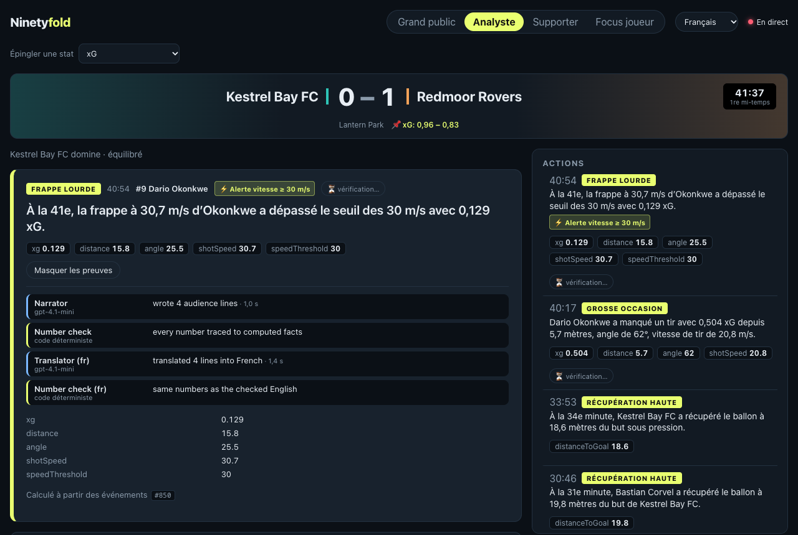
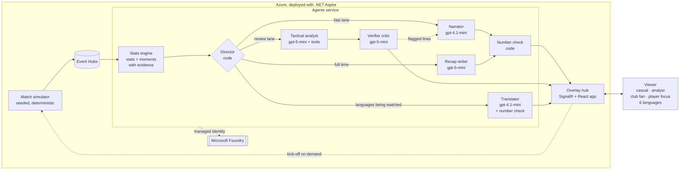

# Ninetyfold

**An AI broadcast studio for explainable, personalised match intelligence.**

Ninetyfold watches a live (synthetic) football match and runs a small studio of AI agents over it. Code computes every statistic; the agents explain *why* each moment matters, check each other's work, and tell the same match differently to a casual fan, an analyst, a supporter of either club, or someone following one player, in English, French, Spanish, German, Portuguese or Italian. At full time they write the match report.

> **Numbers come from code; words come from AI.** Models never calculate a statistic. They only word facts that the stats engine has already computed, every number they write is checked against those facts, and every moment cites the events behind it.

**Live demo:** https://overlayhub.whitemeadow-6a3a991d.swedencentral.azurecontainerapps.io. Matches play on demand: opening the page kicks one off within seconds (one match is about 9 minutes at 10× speed).

*All clubs, players, venues and match data are fictional and generated synthetically. Built for the* Inside the Game *developer hackathon, October 2026. The code still uses the working name `MatchDirector` for its projects and namespaces.*

| Analyst | Club fan |
|---|---|
|  |  |
| **Casual fan** | **Player focus** |
|  |  |



## How it works



1. **Simulator** plays a seeded, possession-based match (passes, carries, pressures, tackles, shots, saves, goals with pitch coordinates) and streams it to **Event Hubs**. Matches only play while someone is watching.
2. **Stats engine** (plain C#, no AI) turns events into team and player stats and detects *moments* (goals, big chances, key saves, passing moves, killer passes, high regains, momentum and tempo shifts). It also raises **speed and distance alerts** when a player crosses a published threshold (a shot at 30 m/s or more, a carry of 12 m or more at 6.9 m/s or more) and **milestones** (every 150 m a player has carried the ball, a brace, a hat-trick). Each moment carries its computed metrics and the IDs of the events it was computed from.
3. **Director** (code) runs a fast lane and a review lane per moment, plus a translation lane:
   - **Fast lane**: the **Narrator** writes four lines (casual, analyst, home fan, away fan); **code checks every number** against the facts; the overlay is on air in about two seconds.
   - **Review lane**: for non-routine moments the **Verifier critic** checks the meaning (right team and player, right side for fan lines, right score story, no invented history). Flagged lines go back to the Narrator, are rechecked, and are replaced by a deterministic template if they fail twice. For important moments the **Tactical analyst** explains why it matters, looking stats up through code tools; its numbers are checked too.
   - **Full time**: the **Recap writer** drafts the match report from code-computed facts. **Player of the match** is chosen by a published formula in the stats engine, not by the AI. The report is number-checked and critic-reviewed.
   - **Translation lane**: the **Translator** translates the checked lines and reports into the languages viewers are actually watching in, and only those. Code then checks that each translated line carries exactly the numbers of its English line; a line that fails is shown in English with a small "EN" tag. Someone who switches language mid-match gets the recent moments and the report translated within seconds.
4. **Overlay hub** pushes overlays, live stats and reports over SignalR. Each overlay carries an **agent trace** (which agent or check ran, on which model, how long it took, what it found), shown under "Why am I seeing this?".
5. **Viewer modes** are different experiences, not just different wording: casual (headline moments, big text), analyst (every metric, evidence open, influential players), club fan (partisan narration, us v them, opponent moments muted) and player focus (live player card, only that player's moments). Any view can pin one stat, switch language (the whole interface, the commentary and the number formats) and be shared as a link, for example `?mode=club&club=RDM&lang=fr` or `?mode=player&player=KBY-09`.

## Challenge stages

| Stage | What Ninetyfold does | Where to look |
|---|---|---|
| (a) Ingest live events | Deterministic simulator streaming to Event Hubs; JSON-lines export as a reusable synthetic dataset | [`src/MatchDirector.Simulator`](src/MatchDirector.Simulator) |
| (b) Interpret into stats and patterns | xG from distance and angle, pass difficulty and progression, ball and shot speed, possession by time, momentum, control vs chaos, player ratings; speed and distance alerts at published thresholds; milestones | [`src/MatchDirector.StatsEngine`](src/MatchDirector.StatsEngine) |
| (c) Explain why a moment matters | Narrator, Tactical analyst with code tools, Verifier critic, full-time Recap writer, Translator, all evidence-backed | [`src/MatchDirector.Agents`](src/MatchDirector.Agents) |
| (d) Timed, machine-readable overlays | `Overlay` contract (show time, duration, priority, metrics, evidence, variants, agent trace) pushed over SignalR | [`src/MatchDirector.Contracts`](src/MatchDirector.Contracts), [`src/MatchDirector.OverlayHub`](src/MatchDirector.OverlayHub) |
| (e) Personalise | Casual, analyst, club fan and player focus modes; six languages; pin a stat; shareable links | [`src/web`](src/web) |

## Judging criteria

| Criterion | Evidence |
|---|---|
| **Technological implementation** | .NET 10 + Aspire, Microsoft Agent Framework, Microsoft Foundry, Event Hubs, Container Apps, React 19. 159 unit tests and an [evaluation harness](docs/evaluation.md) with a CI quality gate. |
| **Agentic design and innovation** | A code Director orchestrating five agents across a fast lane, a review lane and an on-demand translation lane; a critic-and-rewrite loop with a deterministic backstop; an analyst that looks stats up through tools instead of computing them; a visible agent trace on every overlay. |
| **Real-world impact** | Deployed on Azure with managed identity only (no keys anywhere), self-healing after restarts, Application Insights tracing every agent and model call with token usage, on-demand play so idle cost is about USD 1.6 a day and a watched match about USD 0.05, a budget alert, and seeded matches that replay exactly. |
| **UX and presentation** | Four genuinely different viewer experiences in six languages, speed alerts and milestones, "Why am I seeing this?" on every overlay and report, shareable views, mobile-friendly layout. |
| **Category adherence** | All five required stages, plus suggested features: player tagging with speed and distance indicators at thresholds, notable milestones, multi-language commentary, pass difficulty, ball and shot speed, control vs chaos, synthetic dataset creation and match recaps. |

## Best Multi-Agent System

Ninetyfold is entered in the **Best Multi-Agent System** category. The studio is built the way a broadcast gallery works: specialists with one job each, a director who decides what goes on air, and checks between every hand-off.

| The category asks for | How Ninetyfold does it |
|---|---|
| **Distinct roles** | Five agents, each with one job, instructions and model: the **Narrator** (gpt-4.1-mini) words a moment for four audiences; the **Tactical analyst** (gpt-5-mini) explains why it matters, looking stats up through code tools; the **Verifier critic** (gpt-5-mini) checks meaning; the **Recap writer** (gpt-5-mini) writes the full-time report; the **Translator** (gpt-4.1-mini) serves other languages. The **Director** and the **number checks** are deliberately code, not agents. |
| **Shared state and hand-offs** | Every agent works from the same computed facts (metrics with units, evidence event IDs, and fan moods and player roles decided in code). An overlay is handed from lane to lane by ID: the fast lane airs it, the review lane republishes it corrected and annotated, and the translation lane adds languages, but only while the English lines it translated are still the ones on screen. |
| **Recovering from failures** | Every hand-off has a check and a fallback: an invented number sends the template on air; a critic flag sends the lines back to the Narrator, then a recheck, then the template; a translated line with a changed number falls back to English; a model outage leaves template narration running; a restarted service catches up from Event Hubs and the hub is re-announced every 30 seconds. |
| **A result no single agent could match** | One prompt cannot be fast, fact-checked, partisan, explained and multilingual at once. Splitting the work puts a checked overlay on air in about two seconds, reviews it within seconds more, and keeps every number traceable to the stats engine in every language. The agent trace under each overlay shows every step. |

## Try it

The [live demo](https://overlayhub.whitemeadow-6a3a991d.swedencentral.azurecontainerapps.io) needs no sign-in. A match starts within seconds of opening the page and lasts about 9 minutes.

1. **Watch the casual view**: big moments in plain words. Pin a stat from the menu.
2. **Switch to Analyst**: every metric, the most influential players, and under each moment the agent trace (Narrator, number check, Tactical analyst, Verifier critic) with models and timings.
3. **Switch to Club fan** and pick a club: the same moments told from that club's side, with "us" and "them".
4. **Switch to Player focus** and follow a player: their live card, including fastest shot and top carry speed, and only their moments.
5. **Pick Français (or Español, Deutsch, Português, Italiano)** from the language menu: the interface switches at once, and within a few seconds the commentary is translated too. The trace shows the Translator and its own number check. A line still in English carries a small "EN" tag.
6. **Look out for ⚡ speed alerts** (rocket shots, driving runs), distance milestones, braces and hat-tricks.
7. **Stay to full time** for the match report and player of the match, then kick off another match.

Every view can be shared as a link, for example `?mode=club&club=RDM&lang=es`. The deterministic evaluation runs locally with no Azure account: `dotnet run --project eval/MatchDirector.Eval`.

## Evaluation

[`eval/MatchDirector.Eval`](eval/MatchDirector.Eval) measures the "numbers come from code" promise and the agent team. Latest results ([full report](docs/evaluation.md)):

| What | Result |
|---|---|
| Moments citing valid, earlier events | **100%** of 1,959 (50 matches, 96,650 events) |
| Fallback narration and full-time reports passing the number check | **100%** |
| Invented statistics blocked by code (red team) | **100%** |
| Meaning errors caught by the verifier critic (red team) | **94%**, with **0%** false alarms on correct lines (94–98% across runs; swapped fan lines are the hardest) |
| Full-time reports passing both checks, live models | 2 of 2 written by the AI and approved |
| Narrator latency, live models | p50 1.1 s · p95 1.5 s |
| Translated lines keeping exactly the English line's numbers (French, Spanish, German, Portuguese, Italian) | **100%** of 185 (98.4–100% across runs; a line that fails is shown in English) |
| Model cost per watched match (measured in Application Insights) | about USD 0.05 |

The deterministic guarantees run in CI on every push, and the build fails if any of them drops below 100%. The evaluation also found and fixed three bugs in our own fallback text that unit tests had missed.

## Design decisions

- **Code computes, AI words.** Agents receive computed facts with units and a plain meaning per moment type. A regex-based number check rejects any number not in the facts, before anything reaches the screen.
- **Two lanes, not one long chain.** Viewers get a checked overlay in about two seconds; the slower review happens in the background and updates the same overlay in place. Each lane drops its oldest work rather than falling behind the live match.
- **A backstop for every model.** Every agent output has a deterministic template fallback that is itself verified by the evaluation, so a model outage or a bad answer never leaves the screen blank or wrong.
- **Judgement stays in code.** Player of the match, moment detection and priorities are formulas in the stats engine, documented and tested, never a model's opinion.
- **Cost-aware by design.** Matches play only when someone is watching, one per kick-off request, and pause after two minutes with no viewers. The studio translates only into languages someone is reading at that moment.
- **Thresholds are published.** Speed alerts and milestones fire at constants in the stats engine (`Thresholds`), tested at the boundary, so an alert is never a model's impression.
- **Synthetic and reproducible.** Fictional clubs and players; the same seed always produces the same match, which makes tests and evaluation exact.

## Repository layout

```
src/
  MatchDirector.AppHost          .NET Aspire orchestration (local run and Azure deployment)
  MatchDirector.ServiceDefaults  OpenTelemetry, health checks, resilience
  MatchDirector.Contracts        Event, overlay and report schemas
  MatchDirector.Simulator        Synthetic match engine
  MatchDirector.StatsEngine      Deterministic football statistics, moments and player ratings
  MatchDirector.Agents           Director and agent studio (Microsoft Agent Framework)
  MatchDirector.OverlayHub       Real-time overlay hub (SignalR), serves the web app
  web                            React + Vite viewer
tests/                           Unit tests
eval/                            Evaluation harness (guarantees, live agents, red team)
docs/                            Evaluation report and screenshots
infra/                           Budget alert (Bicep); other Azure resources are generated by Aspire
.github/                         CI, GitHub Copilot instructions and prompts
```

## Run locally

Requirements: .NET 10 SDK, Node.js 22+, Docker (for the Event Hubs emulator) and an Azure subscription for the Foundry models.

```bash
cd src/web && npm install && cd ../..
dotnet run --project src/MatchDirector.AppHost
```

The Aspire dashboard opens with every service, its logs and its traces. Open the `web` endpoint to kick off a match. Without Foundry settings the studio still runs, using deterministic template narration only.

### Azure resources

Event Hubs runs in a local emulator. Microsoft Foundry is provisioned in Azure on first run: a Foundry resource with a project, `gpt-5-mini` ("reasoning") and `gpt-4.1-mini` ("fast") deployments, and a monthly budget alert ([infra/budget.bicep](infra/budget.bicep)). Local auth is disabled, so services use managed identity or your Azure CLI login, and no keys exist.

Tell Aspire where to provision (user-secrets, never committed):

```bash
cd src/MatchDirector.AppHost
dotnet user-secrets set Azure:SubscriptionId <subscription-id>
dotnet user-secrets set Azure:TenantId <tenant-id>
dotnet user-secrets set Azure:Location swedencentral
dotnet user-secrets set Azure:ResourceGroup <resource-group>
dotnet user-secrets set Azure:CredentialSource AzureCli
dotnet user-secrets set Parameters:budgetEmail <you@example.com>
```

### Deploy to Azure

Deploys to Azure Container Apps with Event Hubs, the Foundry models and managed identity throughout. The overlay hub serves the built React app.

```bash
aspire deploy --apphost src/MatchDirector.AppHost/MatchDirector.AppHost.csproj
```

User-secrets are not loaded when deploying, so supply the same settings as `Azure__SubscriptionId`, `Azure__TenantId`, `Azure__Location`, `Azure__ResourceGroup` and `Parameters__budgetEmail` environment variables. Simulator, agents and overlay hub each run as one 0.25 vCPU replica. Idle cost is about USD 1.6 a day; each watched match adds roughly USD 0.05–0.10 in model calls.

### Evaluation

```bash
dotnet run --project eval/MatchDirector.Eval                                      # deterministic checks and the code half of the red team
dotnet run --project eval/MatchDirector.Eval -- --endpoint <foundry-endpoint>     # full run against the models (Azure CLI login)
```

### Synthetic matches

The simulator plays *Kestrel Bay FC v Redmoor Rovers* (both fictional) as a seeded, deterministic possession model. It is calibrated against typical top-flight averages per match: about 2.8 goals, 27 shots, 900 passes and 79% pass accuracy, with a median shot distance of 15 m. Set `Simulator__Seed` to replay a match, `Simulator__Speed` (1–20) to set the replay speed, and `Simulator__OnDemand=false` to play continuously. To export a full match as a JSON-lines dataset:

```bash
dotnet run --project src/MatchDirector.Simulator -- export 42 match-42.jsonl
```

## Responsible AI and limitations

- The models only word computed facts; numbers are enforced by code, and meaning by a second model whose red-team recall is 94–98%, not 100%. When the critic flags a line twice, a deterministic template goes on air instead.
- The fast narrator still overstates or slips on fan lines in roughly 15–18% of reviewed moments (down from about 20% before fan moods and player roles were computed in code). The critic catches these and they are rewritten or replaced by the template.
- Reviews take 5–15 seconds, so a corrected or annotated overlay can arrive after the original has been shown; the moments feed always shows the reviewed version.
- Translations are checked for numbers by code but not reviewed for meaning by the critic, so wording can be less idiomatic than the English. Only left-to-right languages are offered, so the layout never changes.
- All data is synthetic. Real tracking or event data would need a loader into the same `MatchEvent` contract.

## Future work

- **Auto-eventing from video**: a vision model that turns broadcast footage into the same `MatchEvent` stream, so the studio runs on real matches without a data feed.
- **An MCP server** exposing the stats engine's tools, so any agent or copilot can ask about the live match and get the same code-computed answers.
- **Right-to-left languages** such as Arabic, with a mirrored layout, and spoken commentary per language.

## License

[MIT](LICENSE)
